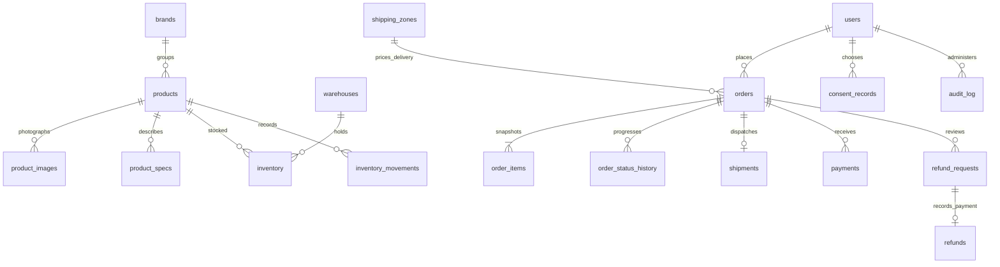

# Database and fulfilment design

The canonical schema is database/schema.sql. The phpMyAdmin import is database/mysql-schema.sql. SQLite is the explicitly selected local engine; MySQL is the self-hosted production option. All money is stored in integer paisa, dates in UTC ISO 8601, and customer-facing dates use Asia/Dhaka.

| Area | Tables | Purpose |
| --- | --- | --- |
| Business | business_details, locations, site_content | Source-backed contact/store information, registered operator and tax treatment, database-driven editorial content |
| Identity | users, sessions | Exactly admin/customer roles; hashed passwords, opaque session hashes and CSRF secrets |
| Catalogue | brands, products, product_specs, product_images | Facts/prices/images with source provenance, published/featured controls |
| Stock | warehouses, inventory, inventory_movements | Real stock counts, reservations, purchase cost and adjustment audit |
| Delivery | shipping_zones, orders, order_items, order_status_history, shipments | Doorstep address snapshot, zone charges, order lifecycle, carrier/tracking and actual shipping cost |
| Finance | payments, refund_requests, refunds, expenses | Actual receipts/refunds/expenses with unique transaction or invoice references |
| Governance | policies, consent_records, audit_log | Versioned policy approval/acceptance, optional consent and staff audit events |
| Analytics | analytics_daily | Only day + coarse route + aggregate count after consent |

## Lifecycle

Checkout requires a real registered operator, registration number/address, explicit confirmed tax treatment, published terms/refund policies and verified physical stock. A public source's `available` boolean never becomes a warehouse count.

Placed → Confirmed → Packed → Shipped → Delivered. Cancellation is available before shipment. Changes are checked on the server, restricted by role, wrapped in transactions and recorded in history.

- Placement locks/selects sufficient inventory, snapshots product name/model/price/cost, delivery address, tax treatment/rate and policy versions, and reserves stock. A unique idempotency key prevents duplicate order creation.
- Cancellation releases reservations without changing physical stock or inventing a refund.
- Dispatch requires the carrier and tracking reference and any required recorded advance payment. It deducts both reserved and physical stock once.
- Delivery updates history and the actual delivery timestamp.
- Refund requests are reviewed; a refund is recorded only after approval, with its actual transaction reference and amount. It cannot exceed unrefunded recorded payments. Returned items must be inspected and restocked explicitly through an inventory adjustment.

## Accounting boundaries

Listed prices are source-backed. The business must select inclusive tax, exclusive tax or a confirmed exemption; unknown tax is never silently treated as an exemption. Rates are basis points, and tax rounds to integer paisa. Shipping-zone fees are final charges as configured by the business; bespoke tax treatment of shipping requires configuration/code review before launch.

Delivered sales exclude recorded product tax. Payments collected and outstanding amounts are separate measures. Recorded margin subtracts snapshot item costs, refunds, expenses and carrier costs from delivered sales; missing delivered-item costs yield an unavailable margin, never an invented estimate. This operational summary does not replace a reconciled statutory ledger. Partial refunds and tax adjustments should be reviewed against actual invoices and business accounting requirements.

Payments, refunds and expenses are append-only in the application UI. Errors require a documented reconciliation through an authorised database administrator rather than silently rewriting a receipt. Orders, policies, product costs and historical sale prices are preserved as snapshots.

## Access and operations

Customers can read/cancel/request refunds only for their own orders. Public registration always creates a customer regardless of submitted role. Admin mutations are server-authorised and audited; prepared parameters prevent input from becoming SQL. Database explorer table names are allowlisted, and application responses exclude password hashes/session secrets.

The MySQL adapter uses a pool and row locks for transactional inventory/orders. InnoDB constraints/indexes support relations and prevent invalid quantities. phpMyAdmin runs locally; use it for full inspection, additional confirmed catalogue/store/zone entries, encrypted backups and reconciliation. Keep the MySQL and phpMyAdmin ports off the public internet.

No customer birthdays, gender profiles, identity documents, card secrets or fingerprint identifiers are collected. Delivery addresses are captured only in an order. Account/order retention and legal accounting obligations must be set by the business; this implementation does not invent retention periods or erase required financial history.
